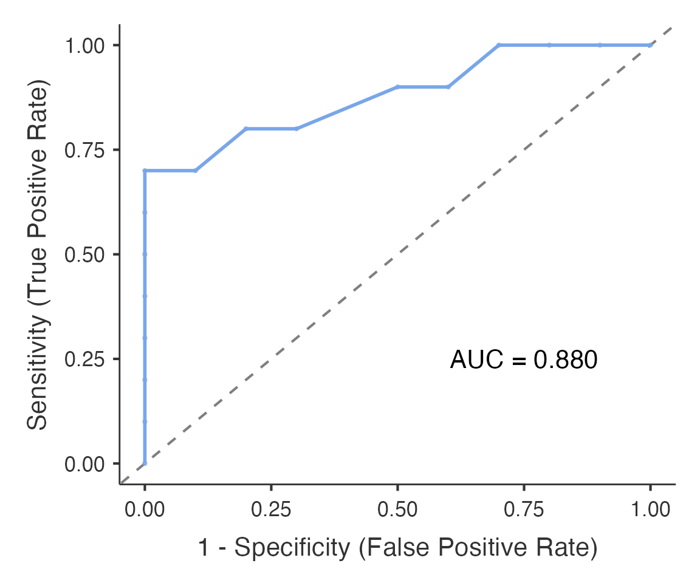

# ROC Curve Analysis

This article is a short introduction to ROC analysis with **Advanced ROC
Analysis**
([`psychopdaROC()`](https://www.serdarbalci.com/meddecide/reference/psychopdaROC.md),
**meddecide \> ROC**). For every option see the [comprehensive
guide](https://www.serdarbalci.com/meddecide/articles/meddecide-psychopdaroc-comprehensive.md);
for a clinically oriented alternative see [Clinical ROC
Analysis](https://www.serdarbalci.com/meddecide/articles/meddecide-enhancedroc-comprehensive.md).

## Data

\
`df_roc`` ``<-`` `[`read.csv`](https://rdrr.io/r/utils/read.table.html)`(`[`system.file`](https://rdrr.io/r/base/system.file.html)`(``"extdata"``, ``"roc_example.csv"``, package ``=`` ``"meddecide"``)``)`\
[`table`](https://rdrr.io/r/base/table.html)`(``df_roc``$``class``)`\
`#> `\
`#> neg pos `\
`#>  10  10`

## ROC curve and AUC

Columns are passed by name. Name both the positive and the negative
level of the outcome: they are required, and the analysis waits until
both are chosen rather than guessing which level means “disease”.

\
`roc_res`` ``<-`` `[`psychopdaROC`](https://www.serdarbalci.com/meddecide/reference/psychopdaROC.md)`(`\
`  data ``=`` ``df_roc``,`\
`  dependentVars ``=`` ``"value"``,   ``# marker column(s)`\
`  classVar ``=`` ``"class"``,        ``# outcome column`\
`  positiveClass ``=`` ``"pos"``,`\
`  negativeClass ``=`` ``"neg"``,`\
`  plotROC ``=`` ``TRUE`\
`)`\
\
`roc_res``$``resultsTable``[[``1``]``]``$``asDF``  ``# optimal cut-point, sensitivity, specificity, AUC`\
`#>              cutpoint sensitivity specificity ppv       npv youden  AUC`\
`#> "cutpoint_1"      0.5         0.7           1   1 0.7692308    0.7 0.88`\
`#>              metricValue`\
`#> "cutpoint_1"         0.7`\
`roc_res``$``aucSummaryTable``$``asDF``    ``# AUC with its confidence interval`\
`#>         variable  auc  ci_lower  ci_upper           p`\
`#> "value"    value 0.88 0.6269735 0.9696931 0.008030168`\
`roc_res``$``plotROC``[[``1``]``]``            ``# ROC curve`

`resultsTable` and `plotROC` hold one element per marker, hence `[[1]]`.

By default the cut-point maximises Youden’s J (sensitivity +
specificity - 1) and the AUC confidence interval uses DeLong’s standard
error on the logit scale (`aucInference = "logit"`). With 20 cases, as
here, the interval is wide and the “optimal” cut-point is unstable; a
cut-point chosen on the same data looks better than it will on new
patients.

## Choosing a threshold

- **Youden’s J** balances sensitivity and specificity. It ignores
  prevalence and the different costs of false positives and false
  negatives.

For a marker that is higher in disease:

- **Rule-out**: pick the highest threshold that still gives the required
  sensitivity (for example at least 0.95).
- **Rule-in**: pick the lowest threshold that gives the required
  specificity.
- **Consequences**: when the harms of the two errors differ, use a cost
  ratio (`method = "oc_cost_ratio"`) or a decision curve
  ([`decisioncurve()`](https://www.serdarbalci.com/meddecide/reference/decisioncurve.md),
  **meddecide \> Decision Curve Analysis**).

`sensSpecTable = TRUE` adds a confusion matrix at the chosen cut-point,
and `fixedSensSpecAnalysis = TRUE` reports the threshold that achieves a
fixed sensitivity or specificity.
