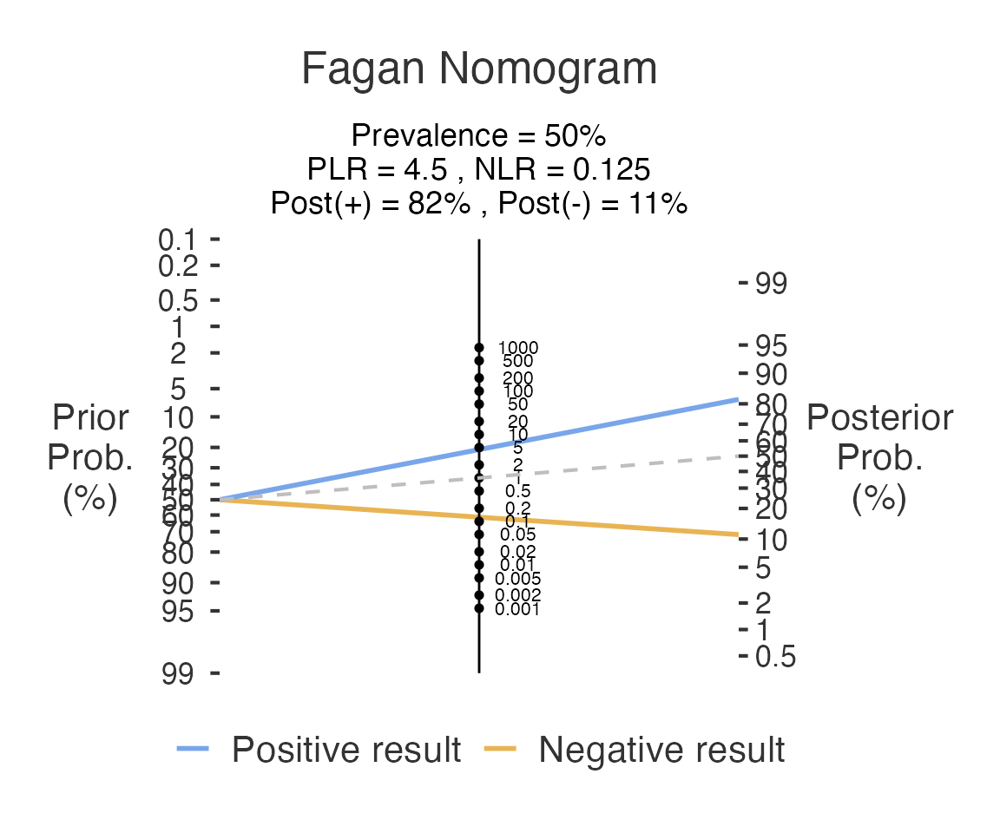

# Diagnostic Test Evaluation

This article shows the two basic diagnostic-accuracy analyses:

- **Medical Decision**
  ([`decision()`](https://www.serdarbalci.com/meddecide/reference/decision.md),
  **meddecide \> Decision**) works from raw data: one column for the
  reference standard, one for the test.
- **Medical Decision Calculator**
  ([`decisioncalculator()`](https://www.serdarbalci.com/meddecide/reference/decisioncalculator.md),
  **meddecide \> Decision Calculators**) works from the four cell
  counts.

## From raw data: `decision()`

A tiny example file ships with the package.

\
`df_dec`` ``<-`` `[`read.csv`](https://rdrr.io/r/utils/read.table.html)`(`[`system.file`](https://rdrr.io/r/base/system.file.html)`(``"extdata"``, ``"decision_example.csv"``, package ``=`` ``"meddecide"``)``)`\
`df_dec``$``gold``    ``<-`` `[`factor`](https://rdrr.io/r/base/factor.html)`(``df_dec``$``gold``)`\
`df_dec``$``newtest`` ``<-`` `[`factor`](https://rdrr.io/r/base/factor.html)`(``df_dec``$``newtest``)`\
[`str`](https://rdrr.io/r/utils/str.html)`(``df_dec``)`\
`#> 'data.frame':    10 obs. of  2 variables:`\
`#>  $ newtest: Factor w/ 2 levels "0","1": 2 2 1 2 1 1 2 1 1 2`\
`#>  $ gold   : Factor w/ 2 levels "0","1": 2 1 2 2 1 1 2 2 1 1`

Columns are passed **by name**. Name the positive *and* the negative
level of both the reference standard and the test; all four are
required, so the analysis never guesses which level means “disease”.

\
`res`` ``<-`` `[`decision`](https://www.serdarbalci.com/meddecide/reference/decision.md)`(`\
`  data ``=`` ``df_dec``,`\
`  gold ``=`` ``"gold"``,`\
`  goldPositive ``=`` ``"1"``,`\
`  goldNegative ``=`` ``"0"``,`\
`  newtest ``=`` ``"newtest"``,`\
`  testPositive ``=`` ``"1"``,`\
`  testNegative ``=`` ``"0"``,`\
`  ci ``=`` ``TRUE`\
`)`\
`res``$``cTable``$``asDF``      ``# 2 x 2 table`\
`#>                       newtest GP GN Total`\
`#> "Test Positive" Test Positive  3  2     5`\
`#> "Test Negative" Test Negative  2  3     5`\
`#> "Total"                 Total  5  5    10`\
`res``$``ratioTable``$``asDF``  ``# sensitivity, specificity, PPV, NPV, likelihood ratios`\
`#>     tablename Sens Spec AccurT PrevalenceD PPV NPV LRP       LRN`\
`#> "1"        NA  0.6  0.6    0.6         0.5 0.6 0.6 1.5 0.6666667`\
`res``$``epirTable_ratio``$``asDF``  ``# sensitivity, specificity, PPV, NPV with 95% CIs (ci = TRUE)`\
`#>                         statsnames est     lower    upper`\
`#> "se"                   Sensitivity 0.6 0.1466328 0.947255`\
`#> "sp"                   Specificity 0.6 0.1466328 0.947255`\
`#> "pv.pos" Positive predictive value 0.6 0.1466328 0.947255`\
`#> "pv.neg" Negative predictive value 0.6 0.1466328 0.947255`

With only 10 cases the confidence intervals are very wide; the example
only shows the mechanics.

## From counts: `decisioncalculator()`

\
`calc`` ``<-`` `[`decisioncalculator`](https://www.serdarbalci.com/meddecide/reference/decisioncalculator.md)`(``TP ``=`` ``90``, FN ``=`` ``10``, TN ``=`` ``80``, FP ``=`` ``20``,`\
`                           ci ``=`` ``TRUE``, fagan ``=`` ``TRUE``)`\
`calc``$``epirTable_ratio``$``asDF``  ``# estimates with 95% confidence intervals`\
`#>                                                        statsnames       est`\
`#> "ap"                                          Apparent prevalence 0.5500000`\
`#> "tp"                 Reference-standard prevalence in this sample 0.5000000`\
`#> "se"                                             Test sensitivity 0.9000000`\
`#> "sp"                                             Test specificity 0.8000000`\
`#> "diag.ac"                                     Diagnostic accuracy 0.8500000`\
`#> "pv.pos"                                Positive predictive value 0.8181818`\
`#> "pv.neg"                                Negative predictive value 0.8888889`\
`#> "p.rout"            Proportion of subjects with outcome ruled out 0.4500000`\
`#> "p.rin"              Proportion of subjects with outcome ruled in 0.5500000`\
`#> "p.tpdn"      False-positive rate among outcome-negative subjects 0.2000000`\
`#> "p.tndp"      False-negative rate among outcome-positive subjects 0.1000000`\
`#> "p.dntp"  False-discovery proportion among test-positive subjects 0.1818182`\
`#> "p.dptn"   False-omission proportion among test-negative subjects 0.1111111`\
`#>                lower     upper`\
`#> "ap"      0.47824931 0.6202464`\
`#> "tp"      0.42865843 0.5713416`\
`#> "se"      0.82377740 0.9509953`\
`#> "sp"      0.70815731 0.8733444`\
`#> "diag.ac" 0.79284130 0.8964505`\
`#> "pv.pos"  0.73325967 0.8852586`\
`#> "pv.neg"  0.80514136 0.9454144`\
`#> "p.rout"  0.37975359 0.5217507`\
`#> "p.rin"   0.47824931 0.6202464`\
`#> "p.tpdn"  0.12665555 0.2918427`\
`#> "p.tndp"  0.04900469 0.1762226`\
`#> "p.dntp"  0.11474139 0.2667403`\
`#> "p.dptn"  0.05458560 0.1948586`\
`calc``$``plot1``           ``# Fagan nomogram`

The Fagan nomogram shows how a positive or negative result moves a
pre-test probability to a post-test probability through the likelihood
ratios. By default the pre-test probability is the prevalence in the
table; set `pp = TRUE` and `pprob` to use a prevalence from your own
population.

## See also

- [Co-Testing
  Analysis](https://www.serdarbalci.com/meddecide/articles/34-cotest-analysis.md)
  and [Sequential
  Testing](https://www.serdarbalci.com/meddecide/articles/36-sequential-testing-comprehensive.md)
  for two tests.
- [Analysis Without Gold
  Standard](https://www.serdarbalci.com/meddecide/articles/12-nogoldstandard.md)
  when there is no reference standard.
