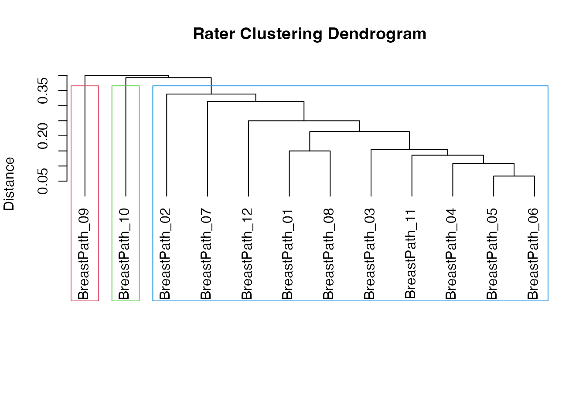

# Diagnostic Style Clustering: Do Pathologists Form Schools?

A single kappa says how much a panel agrees overall. It does not say
whether the disagreement is random or whether the raters split into
groups that read the same slides in systematically different ways.
Usubutun et al. (2012) showed, for endometrial intraepithelial
neoplasia, that 20 pathologists formed distinct “diagnostic styles” by
hierarchical clustering of their diagnoses.

The **Interrater Reliability** analysis
([`agreement()`](https://www.serdarbalci.com/meddecide/reference/agreement.md))
offers this as **Rater clustering**.

## In jamovi

1.  **meddecide \> Agreement \> Interrater Reliability**.
2.  Move one column per pathologist into **Raters**.
3.  Open **Rater and Case Diagnostics \> Rater Clustering (Identify
    Rating Pattern Groups)** and tick **Rater clustering**.
4.  Choose:
    - **Clustering method**: *Hierarchical (dendrogram)* (default) or
      *K-means*.
    - **Distance metric**: default *Concordance (1 - Lin’s CCC)*. For
      categorical diagnoses, *Exact agreement (categorical)* uses the
      proportion of cases on which two raters disagree.
    - **Linkage method (hierarchical)**: default *Average linkage
      (UPGMA)*.
    - **Number of clusters**: where to cut the dendrogram (default 3).
5.  **Dendrogram** and **Cluster heatmap** are on by default.

To reproduce the Usubutun approach, use **Distance metric = Exact
agreement (categorical)** and **Linkage = Ward linkage (minimum
variance)**.

Rater characteristics (experience, training institution) are not inputs
of the analysis. Compare the cluster memberships with them afterwards,
as below.

## In R

The bundled `breast_diagnostic_styles` data holds 12 breast
pathologists’ diagnoses of 60 cases (object `breast_data`).

\
[`data`](https://rdrr.io/r/utils/data.html)`(``breast_diagnostic_styles``)`\
`dx`` ``<-`` ``breast_data``$``diagnosis_data`\
`res`` ``<-`` `[`agreement`](https://www.serdarbalci.com/meddecide/reference/agreement.md)`(`\
`  data ``=`` ``dx``,`\
`  vars ``=`` `[`sprintf`](https://rdrr.io/r/base/sprintf.html)`(``"BreastPath_%02d"``, ``1``:``12``)``,`\
`  raterClustering ``=`` ``TRUE``,`\
`  clusterMethod ``=`` ``"hierarchical"``,`\
`  clusterDistance ``=`` ``"agreement"``,`\
`  clusterLinkage ``=`` ``"ward"``,`\
`  nClusters ``=`` ``3`\
`)`\
\
`res``$``irrtable``$``asDF`\
`#>        method subjects raters peragree     kappa  ci_lower  ci_upper        z`\
`#> "1" Fleiss' κ       60     12       20 0.6776424 0.6199937 0.7352911 23.52108`\
`#>                p`\
`#> "1" 1.153025e-31`\
`clusters`` ``<-`` ``res``$``raterClusterGroup``$``raterClusterTable``$``asDF`\
`clusters`\
`#>                         rater cluster cluster_size avg_similarity`\
`#> "BreastPath_01" BreastPath_01       1           10      0.8222222`\
`#> "BreastPath_02" BreastPath_02       1           10      0.7203704`\
`#> "BreastPath_03" BreastPath_03       1           10      0.8166667`\
`#> "BreastPath_04" BreastPath_04       1           10      0.8296296`\
`#> "BreastPath_05" BreastPath_05       1           10      0.8574074`\
`#> "BreastPath_06" BreastPath_06       1           10      0.8500000`\
`#> "BreastPath_07" BreastPath_07       1           10      0.7333333`\
`#> "BreastPath_08" BreastPath_08       1           10      0.7907407`\
`#> "BreastPath_09" BreastPath_09       2            1             NA`\
`#> "BreastPath_10" BreastPath_10       3            1             NA`\
`#> "BreastPath_11" BreastPath_11       1           10      0.8166667`\
`#> "BreastPath_12" BreastPath_12       1           10      0.7629630`

The `cluster` column is the group of each rater; `avg_similarity` is the
mean similarity (here, proportion of agreement) with the other members
of the same cluster, and is empty for a rater who forms a cluster alone.

\
`res``$``raterClusterGroup``$``raterDendrogram`

### Relating clusters to rater characteristics

\
`info`` ``<-`` ``breast_data``$``pathologist_info`\
`merged`` ``<-`` `[`merge`](https://rdrr.io/r/base/merge.html)`(``clusters``, ``info``, by.x ``=`` ``"rater"``, by.y ``=`` ``"pathologist_id"``)`\
[`table`](https://rdrr.io/r/base/table.html)`(``merged``$``cluster``, ``merged``$``experience_level``)`\
`#>    `\
`#>     Junior Mid-level Senior`\
`#>   1      3         2      5`\
`#>   2      0         1      0`\
`#>   3      0         0      1`\
[`table`](https://rdrr.io/r/base/table.html)`(``merged``$``cluster``, ``merged``$``diagnostic_philosophy``)`\
`#>    `\
`#>     Aggressive Conservative Moderate`\
`#>   1          4            4        2`\
`#>   2          0            0        1`\
`#>   3          0            0        1`

With 12 raters these cross-tables are descriptive only; any test of
association would have very little power.

A second example, `lymphoma_diagnostic_styles` (10 hematopathologists,
45 cases), works the same way with
`vars = sprintf("HemaPath_%02d", 1:10)`.

Pass the rater names as a literal vector or an expression such as
[`sprintf()`](https://rdrr.io/r/base/sprintf.html); like other jamovi
functions,
[`agreement()`](https://www.serdarbalci.com/meddecide/reference/agreement.md)
reads a bare variable name given to `vars` as a column name.

## Interpreting with care

- Clusters are exploratory. Hierarchical clustering always returns a
  tree, even for raters who disagree at random; the number of clusters
  is your choice.
- A rater alone in a cluster is an outlier worth reviewing, not
  necessarily wrong.
- Check stability: rerun with a different linkage (average vs Ward) or
  distance and see whether the same groups reappear.
- Report the overall kappa, the dendrogram, and the cluster memberships
  together.

**Case clustering** (same panel, `caseClustering = TRUE`) groups cases
instead of raters and helps find the case types that drive disagreement.

## References

- Usubutun A, Mutter GL, Saglam A, et al. Reproducibility of endometrial
  intraepithelial neoplasia diagnosis is good, but influenced by the
  diagnostic style of pathologists. *Mod Pathol*. 2012;25(6):877-884.
  <doi:10.1038/modpathol.2011.220>
- Ward JH Jr. Hierarchical grouping to optimize an objective function.
  *J Am Stat Assoc*. 1963;58(301):236-244.
- Elmore JG, Longton GM, Carney PA, et al. Diagnostic concordance among
  pathologists interpreting breast biopsy specimens. *JAMA*.
  2015;313(11):1122-1132.
